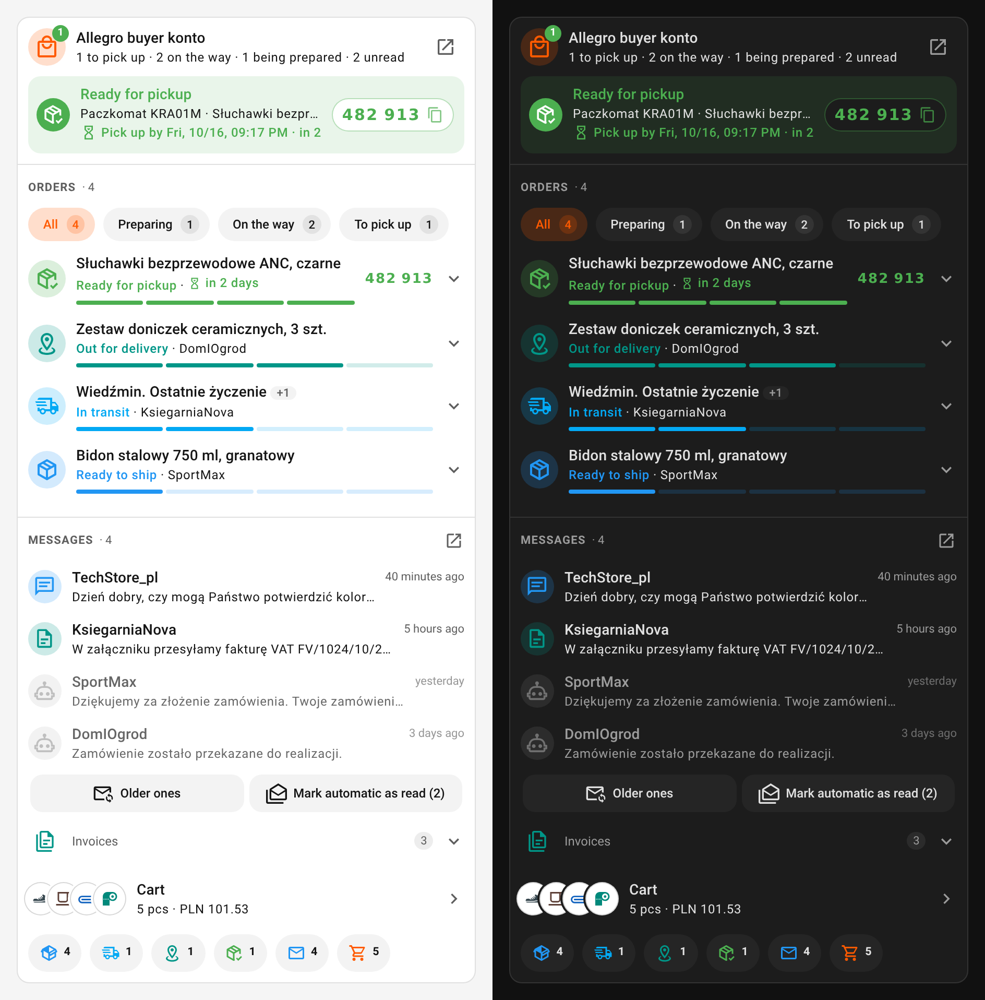
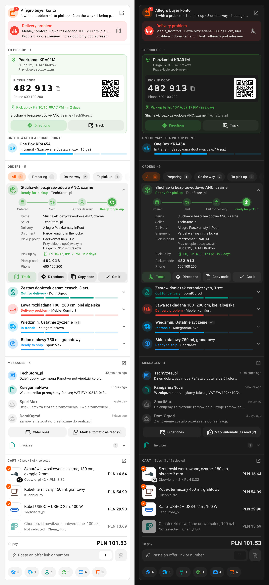
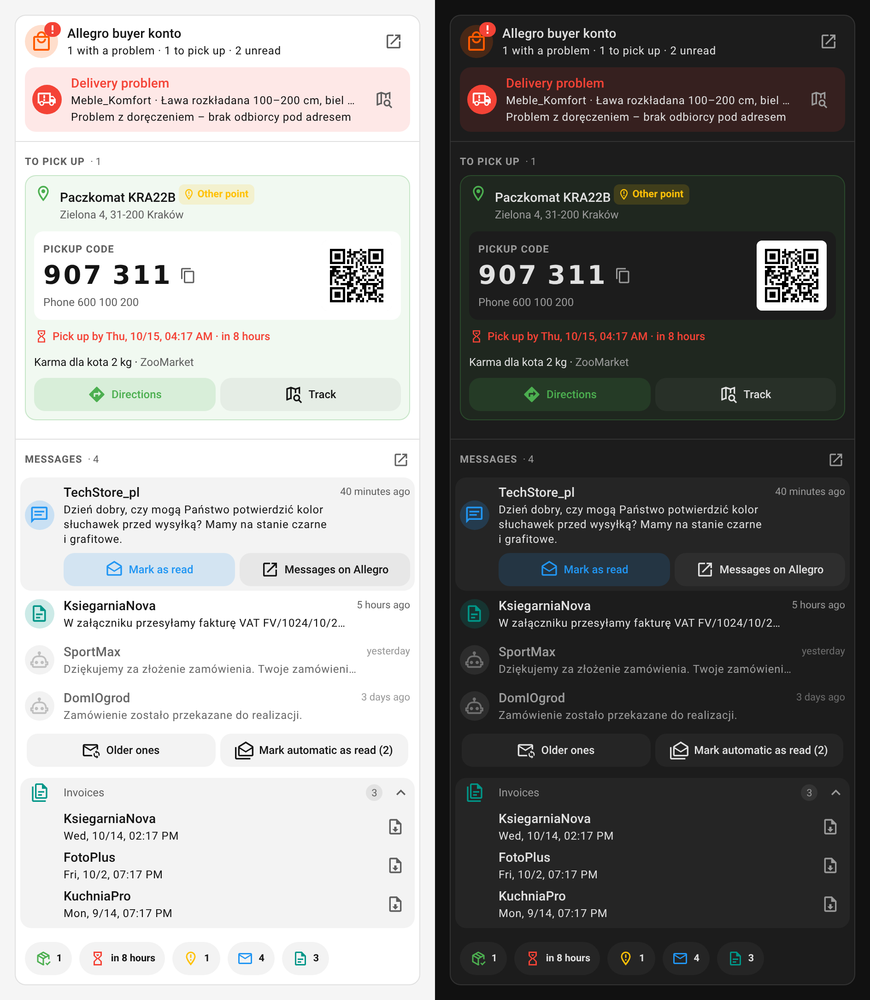
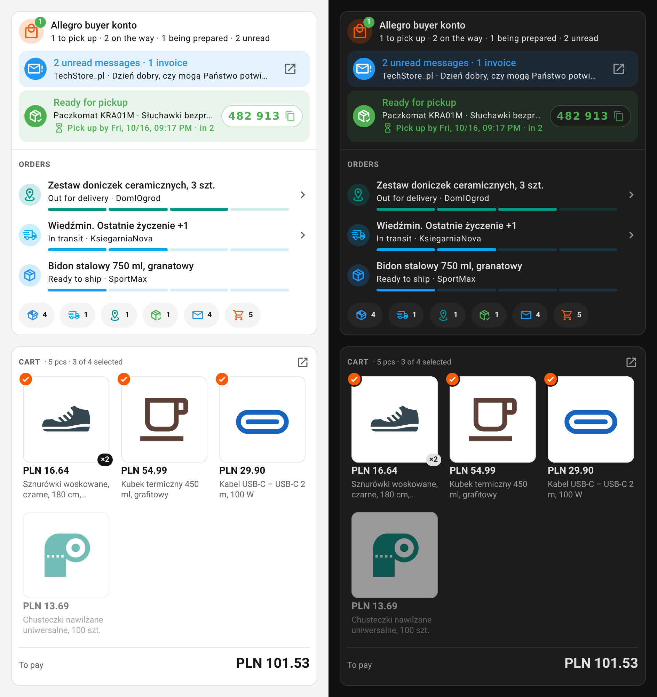
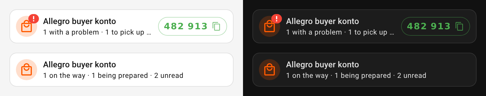

# Allegro buyer Card

[](https://hacs.xyz/docs/faq/custom_repositories)
[](https://github.com/KifKick/allegro-buyer-cards/releases)
[](https://github.com/KifKick/allegro-buyer-cards/actions/workflows/ci.yml)

A dashboard card for the [Allegro buyer](https://github.com/Przemko92/home-assistant-allegro) Home Assistant integration: your parcels, pickup codes and deadlines, seller messages, invoices and cart from [Allegro](https://allegro.pl), in one card you put together from sections. One HACS entry, one JavaScript file, in the style of [Mushroom](https://github.com/piitaya/lovelace-mushroom).



## Features

- **One card, your sections.** Under the account header, pick any of these sections, in any order, each with its own options:
  - **Alerts**: a banner for each parcel waiting for pickup (with its code and deadline), each delivery problem (with the carrier's note) and each unpaid order, plus one for unread seller messages and one when Allegro's data has stopped refreshing (expired session).
  - **To pick up**: the large pickup code (tap to copy), the phone number, the QR code (tap to enlarge), the pickup deadline (red in its last day), an **Other point** tag when the parcel isn't at your default pickup point, the locker or pickup point with directions, and parcels still on their way to one with their estimated delivery.
  - **Orders**: a short list with progress bars, or the full list with stage filters, a journey stepper and details (items, seller, delivery, shipment status, pickup point, deadline and code), with track / directions / copy code / "Got it" buttons.
  - **Messages**: unread seller messages (automatic shop messages dimmed), each one can be marked as read; buttons that mark automatic or older automatic messages as read; and recent invoices, each one savable in Home Assistant.
  - **Cart**: one summary row, a list or photo tiles, with the total to pay and a field that adds an offer to the cart by its link or number.
  - **Counters**: chips for orders in progress, in transit, out for delivery, to pick up, at another pickup point, the nearest pickup deadline, unread messages, invoices, and the cart.
- **Compact layout**: a single row with the account, a summary and the pickup code.
- **No entity configuration**: pick the Allegro account and the card finds its entities itself, whatever the login or UI language.
- **"Got it"**: hide an order you already have while Allegro still lists it (carriers can be slow to report a pickup). Hidden orders are stored in your Home Assistant user profile, so every card and device sees them, and they're forgotten once Allegro drops the order.
- **Visual editor** for every option, in English and Polish.
- **Mushroom look**, driven by Mushroom's own `--mush-*` theme variables, in light and dark themes.

## Requirements

- Home Assistant 2025.1 or newer.
- [Allegro buyer](https://github.com/Przemko92/home-assistant-allegro) **0.1.2 or newer**. Pickup point names and addresses need **0.1.3**. With 0.1.2, the card shows the delivery method instead and leaves out directions.
- Messages, invoices, pickup deadlines, the shipment status, the **Other point** tag and the stale-data banner need **0.2.0**. With older versions those parts just don't show. The **Other point** tag and counter also need a default pickup point set in the integration's options.
- With **0.3.0** or newer, the pickup code, phone number and QR code are no longer sensor attributes (so they stay out of history); the card asks the integration's `allegro.get_pickup_code` service for them each time the orders change. Older versions still send them in the attributes, and the card reads them there.

## Installation

### HACS (recommended)

[](https://my.home-assistant.io/redirect/hacs_repository/?owner=KifKick&repository=allegro-buyer-cards&category=plugin)

Or by hand:

1. In HACS, open **⋮ → Custom repositories**, add `https://github.com/KifKick/allegro-buyer-cards` with the type **Dashboard**.
2. Search for **Allegro buyer Card**, download it, and reload the browser.

HACS registers the dashboard resource for you and updates it with each release.

### Manual

1. Download `allegro-buyer-cards.js` from the [latest release](https://github.com/KifKick/allegro-buyer-cards/releases/latest) into your `config/www/` folder.
2. Go to **Settings → Dashboards → ⋮ → Resources → Add resource**, enter `/local/allegro-buyer-cards.js?v=0.3.0` and choose **JavaScript module**.
3. Reload the browser. When you update the file later, bump the `?v=` value so browsers fetch the new version.

## Usage

Open a dashboard in edit mode, choose **Add card** and pick **Allegro**. It's also suggested when you add a card from any Allegro buyer entity. Everything below can be set in the visual editor, which has one group per section; the YAML is for reference.

With a single Allegro account, `device_id` can be left out. With several, set it to pick the account (the editor shows a device picker).

```yaml
type: custom:allegro-card
device_id: <Allegro buyer device>
sections: [alerts, pickup, orders, messages, cart, stats]
orders:
  style: full
  max_items: 5
cart:
  style: list
```



### Card options

| Option | Default | Description |
|---|---|---|
| `device_id` | first Allegro account | Which account to show. |
| `name` | device name | Title in the header. |
| `icon` | `mdi:shopping-outline` | Header icon. |
| `layout` | `default` | `default`, or `compact` for a single row (account, summary, pickup code). |
| `sections` | `[alerts, orders, messages, cart, stats]` | Sections under the header, in this order: any of `alerts`, `pickup`, `orders`, `messages`, `cart`, `stats`. |
| `show_header` | `true` | The account header (name, summary, badge, links). |
| `section_titles` | `true` | Captions above the pickup, orders, messages and cart sections. |
| `show_allegro_link` | `true` | Button in the header that opens *My purchases* on Allegro. |
| `show_update` | `true` | Icon in the header when HACS has an update of the integration. |

The header badge is a red **!** when a delivery has a problem, otherwise the number of parcels waiting for pickup. The summary under the name also counts unread messages (automatic shop messages left out). Tapping the account name or a counter opens the sensor's more-info dialog.

### `alerts`

| Option | Default | Description |
|---|---|---|
| `types` | `[pickup, problem, payment, messages, stale]` | Which banners to show. Pickup banners are left out when the card also has a `pickup` section, and the messages banner when it has a `messages` section. |

`messages` counts unread messages a person wrote or that carry an invoice; automatic shop messages don't raise it. `stale` shows when the integration's last successful refresh is more than 90 minutes old (it refreshes every 30), which usually means the Allegro session has expired; tap it to see when the data was last fetched.

### `pickup`

| Option | Default | Description |
|---|---|---|
| `show_qr` | `true` | Show the QR code when Allegro provides one. Tap it to enlarge it for the locker's scanner. If Allegro sends it as text, the card draws it itself, so no image is loaded from anywhere. |
| `show_phone` | `true` | Show the phone number the parcel is addressed to (lockers ask for it with the code). |
| `show_upcoming` | `true` | List parcels on their way to a locker or pickup point, with the estimated delivery when Allegro has one. |
| `show_deadline` | `true` | When the parcel has to be picked up by, and how long is left. Red in the last 24 hours. |
| `hide_when_empty` | `true` | Leave the section out while nothing is waiting or on its way. |

The code is shown in groups of three, for reading it out at the locker.

### `orders`

| Option | Default | Description |
|---|---|---|
| `style` | `full` | `compact`: a short list with progress bars; tap an order to track it. `full`: filters, journey stepper, details and actions. |
| `max_items` | `5` | Orders shown (per page in the full list; **Show more** adds a page). |
| `filter` | `all` | Filter selected when the card loads (full list). |
| `filters` | `[all, preparing, on_the_way, pickup, problem]` | Filter chips, in this order. `[]` hides the row. **Problems** only appears when there is one. |
| `sort` | `stage` | `stage`: ready for pickup first, then out for delivery, in transit, being prepared. `newest`: Allegro's own order. |
| `show_progress` | `true` | The progress bar on each order, and the journey stepper when it's open. |
| `details` | `[items, seller, delivery, tracking, pickup_point, pickup_deadline, pickup_code]` | Rows in an open order, in this order. `tracking` is the carrier's status (e.g. the estimated delivery), `pickup_point` also notes a parcel waiting at another point, `pickup_code` also shows the phone number. |
| `allow_hide` | `true` | Show the **Got it** button that hides an order. |

In the compact list, orders already shown as a banner aren't listed again. The filters group Allegro's statuses:

| Filter | Statuses |
|---|---|
| `preparing` | New, waiting for payment, paid, being prepared, ready to ship |
| `on_the_way` | Sent, in transit, out for delivery |
| `pickup` | Ready for pickup |
| `problem` | Delivery problem |

Statuses the card doesn't know yet still show, with Allegro's own name and a grey icon.

### `messages`

| Option | Default | Description |
|---|---|---|
| `max_items` | `5` | Messages shown before **Show all**. |
| `show_automatic` | `true` | Also list automatic shop messages ("order received", "being packed"…), dimmed. |
| `show_actions` | `true` | The **Older ones** and **Mark automatic as read** buttons (the integration's own buttons, shown while there are unread automatic messages). |
| `show_invoices` | `true` | A collapsed list of recent messages with an invoice. |
| `hide_when_empty` | `true` | Leave the section out while nothing is unread. |



Tap a message to read all of its preview, mark it as read, or save its invoice. The integration classifies messages by their text: automatic order status messages, invoices, and everything else. **Save invoice** calls `allegro.download_invoice` and saves the attachment in the `allegro_invoices` folder of your Home Assistant configuration; Allegro then marks the message as read, because the attachment is fetched by opening it. **Older ones** marks automatic messages read when they're older than the integration's configured number of days, or the seller has nothing on its way.

### `cart`

| Option | Default | Description |
|---|---|---|
| `style` | `summary` | `summary`: one row with photos, pieces and the total (tap to open the cart on Allegro). `list`, or `grid` for photo tiles: every line, the total to pay and the add field. |
| `max_items` | `8` | Lines shown before **Show all**. `0` shows them all. |
| `show_unselected` | `true` | Also show lines that aren't ticked for checkout (dimmed). The total only counts ticked ones, as on Allegro. |
| `show_add` | `true` | The field that adds an offer to the cart. |

The **add to cart** field takes an offer link (`https://allegro.pl/oferta/…-17748686880`), a link with an `offerId` parameter, or just the number, plus a quantity. It calls the integration's `allegro.add_to_cart` action for this account. Shortened share links don't contain the offer number, so open them first and copy the full link.

### `stats`

The counter chips, in this order: any of `in_progress`, `in_transit`, `in_delivery`, `pickup`, `other_point`, `pickup_deadline`, `messages`, `invoices`, `cart` (pieces) and `cart_total`. Default: `in_progress`, `in_transit`, `in_delivery`, `pickup`, `messages`, `cart`. Chips only take their colour while there's something to count. `pickup_deadline` shows the time left to the nearest deadline and is left out while nothing is waiting; `other_point` needs a default pickup point set in the integration.

### More examples

A minimal card (banners, a short order list and counters), and a cart-only card without the header:

```yaml
type: custom:allegro-card
sections: [alerts, orders, stats]
orders:
  style: compact
  max_items: 3
show_allegro_link: false
```

```yaml
type: custom:allegro-card
show_header: false
sections: [cart]
cart:
  style: grid
  show_add: false
```



The compact layout, with a parcel to pick up and without:



To hide the whole card while nothing is waiting for pickup, use Home Assistant's own [card visibility](https://www.home-assistant.io/dashboards/cards/#showing-or-hiding-a-card-conditionally) with a `numeric_state` condition (above 0) on the account's *Waiting for pickup* sensor.

## Theming

The card reads the same theme variables as Mushroom, with the same defaults, so a Mushroom theme or `card_mod` override restyles it too:

| Variable | Default | Used for |
|---|---|---|
| `--allegro-rgb-accent` | `255, 90, 0` | Allegro orange: header icon, cart, selected filter |
| `--mush-spacing` | `10px` | Padding and gaps |
| `--mush-icon-size` | `36px` | Round state icons |
| `--mush-control-height` / `--mush-control-border-radius` | `42px` / `12px` | Buttons, banners, the add field |
| `--mush-chip-height` / `--mush-chip-border-radius` | `36px` / `19px` | Counter chips (filter chips use 32px) |
| `--mush-card-primary-font-size` / `--mush-card-secondary-font-size` | `14px` / `12px` | Text |
| `--mush-rgb-<color>` (e.g. `--mush-rgb-green`) | Mushroom palette | Status colours, as `r, g, b` |

Example with [card-mod](https://github.com/thomasloven/lovelace-card-mod):

```yaml
type: custom:allegro-card
card_mod:
  style: |
    :host {
      --allegro-rgb-accent: 0, 122, 255;
      --mush-control-border-radius: 20px;
    }
```

## Translations

The card follows the Home Assistant user's language. English and Polish are included, the same as the integration; other languages fall back to English. Strings live in [`src/i18n.ts`](src/i18n.ts), and a test checks every language has all of them. Pull requests with new languages are welcome.

## Troubleshooting

- **"Custom element doesn't exist: allegro-card"**: the resource isn't loaded yet. Reload the browser (on the companion app: **Settings → Companion app → Debugging → Reset frontend cache**) and check the resource is listed under **Settings → Dashboards → Resources**.
- **"No Allegro buyer account found"**: the integration isn't set up, or the configured `device_id` no longer exists. Pick the account again in the card editor.
- **"No data from Allegro"**: the integration's sensors are unavailable, usually because the Allegro session expired. Sign in again from the integration's options.
- **Adding to the cart fails**: the message under the field comes from the integration. Check the offer still exists and the session is valid.

## Development

TypeScript and [Lit](https://lit.dev/), bundled with esbuild into `dist/allegro-buyer-cards.js`. The pickup, full orders and cart list sections are their own elements inside the card, so their state (filter, open order, enlarged QR code, the add field) survives updates.

```bash
npm ci
npm run verify   # typecheck, unit tests, build
npm run watch    # rebuild on change, then point a dashboard resource at the dist file
```

`npm run screenshots` regenerates the images in this README. It renders the built bundle in headless Chromium against stubbed `ha-card`/`ha-icon` elements and a fake `hass` with made-up orders (see [`tools/screenshot-harness`](tools/screenshot-harness)). It needs Python with [Playwright](https://playwright.dev/python/) (`pip install playwright && playwright install chromium`).

To release, bump the version in `package.json`, add a matching section to [`CHANGELOG.md`](CHANGELOG.md), and push a `vX.Y.Z` tag. The release workflow builds the bundle and attaches it to a GitHub release with that changelog section as notes.

## AI disclosure

This card was written **entirely by AI**: Claude Opus 5.5 (Anthropic), via [Claude Code](https://claude.com/claude-code). That covers the TypeScript, the styles, the tests, the screenshot harness and this README. It's covered by unit tests and was checked visually in headless renders against a mocked Home Assistant frontend. If something misbehaves in your setup, please [open an issue](https://github.com/KifKick/allegro-buyer-cards/issues) with your Home Assistant version and the error from the browser console.

## License

MIT, see [LICENSE](LICENSE). Not affiliated with Allegro.
